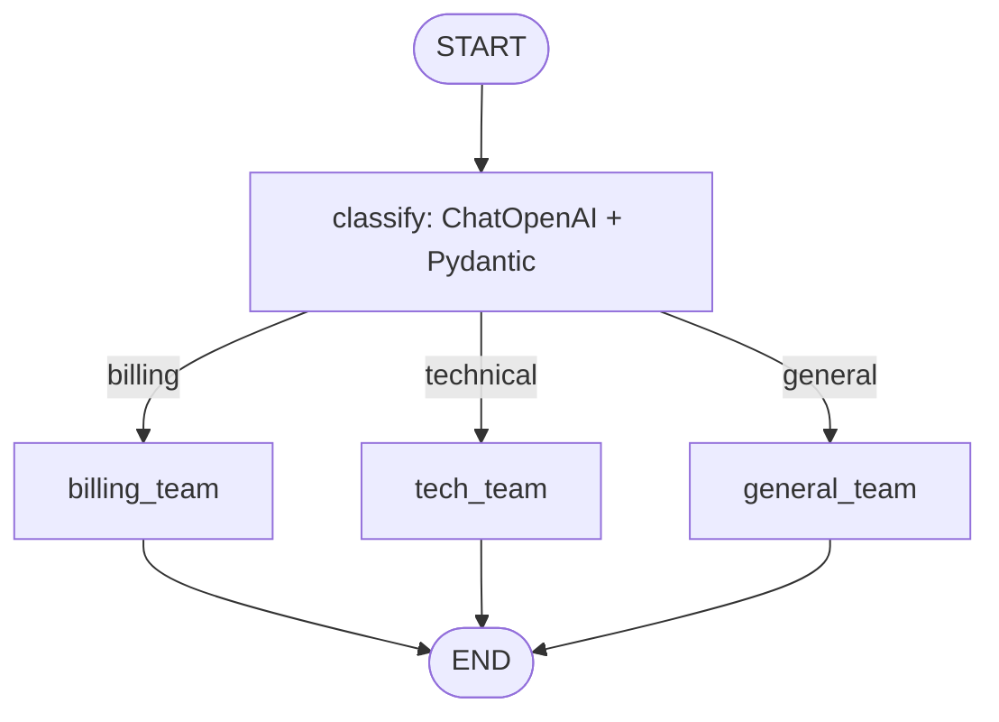

# TaskNest Support Ticket Router

TaskNest receives questions about payments, software problems and everyday product use. This homework uses LangGraph to classify each incoming ticket and route it to a support team with a consistent acknowledgement.

## Files
- `prompt.md`: technical specification and acceptance criteria.
- `ticket_router.ipynb`: complete Google Colab implementation, graph visualization and seven live test tickets.

## Architecture


The shared state contains `ticket`, `category`, `team` and `reply`. The input needs only `ticket`. The `classify` node uses `gpt-4o-mini` at temperature zero with a Pydantic Literal schema. One conditional-edge registration selects a branch by reading only `state["category"]`. Each team node is a plain Python function returning a fixed team name and reply; no further LLM calls are made.

The classifier gives concrete software failures precedence over payment context. For example, “The app crashes every time I try to pay” goes to technical support. Temperature zero reduces variability but does not guarantee identical results across model revisions.

## Run in Google Colab
1. Open [Google Colab](https://colab.research.google.com/) and choose **File → Upload notebook**. Select `ticket_router.ipynb` from this folder.
2. Open **Secrets** using the key icon in the left sidebar.
3. Add a secret named exactly `OPENAI_API_KEY` and paste your OpenAI API key into its value field.
4. Enable **Notebook access** for that secret and allow access if Colab prompts.
5. Use a standard Python CPU runtime; no GPU is required. Select **Runtime → Run all**. The first cell installs the dependencies.
6. Inspect the graph image and the seven printed JSON results. The final assertion reports whether all expected routes and output fields passed.

The notebook reads the key with `from google.colab import userdata` and `userdata.get("OPENAI_API_KEY")`. It never displays the key. Do not paste credentials into notebook cells or commit credentials. OpenAI API access and available credit are required; the test suite makes seven classification requests. Rate limits, authentication errors and model access errors are surfaced rather than replaced with invented results.

Each output includes all four fields. For example, the expected shape for a billing ticket is:
```json
{
  "ticket": "I was charged twice for my monthly subscription.",
  "category": "billing",
  "team": "Billing Team",
  "reply": "Thanks for contacting TaskNest. Our billing team will help with your payment or subscription question."
}
```
This is an illustrative expected result, not a recorded API response. The notebook is supplied with cleared outputs; run it to obtain actual results.

## Troubleshooting
- **Secret not found:** open the key icon (Secrets) in Colab's left sidebar. Add a secret named exactly `OPENAI_API_KEY` and set its value to your OpenAI API key. Enable **Notebook access**, then rerun the credentials cell.
- **Secret access denied:** enable **Notebook access** beside the existing `OPENAI_API_KEY` secret for the notebook you are currently running. Allow access if prompted, then rerun the credentials cell.
- **Secrets request timed out:** run the cell in the Colab browser UI, reconnect the runtime if necessary, and retry. The credentials cell reports these errors separately; it does not bypass Secrets or prompt for the key.
- **Authentication, quota or model access error:** check the API key, account credit and access to `gpt-4o-mini`.
- **Graph image unavailable:** the default Mermaid renderer needs network access. The notebook prints Mermaid source as a fallback and continues to the tests.
- **Unexpected classification:** compare the printed expected and actual categories and the policy in `classify`. Assertions verify intended behavior, not guaranteed model accuracy.

The API references and detailed requirements are in `prompt.md`.

## Reflection

Dana's Bakery used strict, deterministic `if` statements and conditional routes to apply explicit rules for stock, delivery, substitutions, and discounts, whereas this project uses an LLM to interpret a ticket's meaning before deterministic routing selects a team. Semantic classification can recognize intent across varied wording without requiring a separate hand-written condition for every phrasing. For the ambiguous ticket, "The app crashes every time I try to pay", the configured classification policy directs it to the Technical Support Team, matching the test's expected technical category because the crash is the underlying problem and payment is its context. Under this policy, the technical interpretation is correct rather than billing, but the notebook's saved outputs are cleared, so an actual model result and its agreement with that expectation must be confirmed by running the live test. We gain flexibility and better handling of natural language variations, while giving up some predictability, incurring API cost and latency, and replacing simple deterministic classification tests with checks that must account for model variability; the category-to-team mapping and fixed replies remain deterministically testable.
