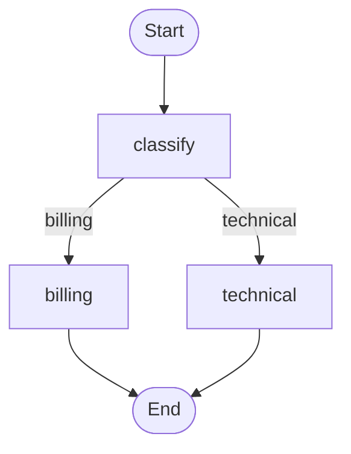

# LangGraph Ticket Router

A simple Python notebook for Google Colab that routes customer support tickets to billing or technical support using LangGraph. Classification uses keyword rules, so no LLM or API key is needed.

## Run in Google Colab

1. Download [`ticket_router.ipynb`](ticket_router.ipynb) from this repository.
2. Open [Google Colab](https://colab.research.google.com/) and choose **File → Upload notebook**.
3. Select the downloaded notebook and connect to a Python runtime.
4. Run the cells from top to bottom, or choose **Runtime → Run all**.

The first code cell installs LangGraph with `%pip install -q langgraph`. Later cells define the state and nodes, build the graph, draw it, and process two sample tickets. No local development setup is required.

Internet access is needed for dependency installation and graph rendering. The visualization cell uses an online Mermaid rendering service and sends the graph structure, not ticket contents. If rendering fails, you can still run the sample ticket cell.

## How It Works

The shared `TicketState` holds three fields:

| Field | Purpose |
| --- | --- |
| `ticket` | Original customer support message |
| `category` | Initially `None`, then `billing` or `technical` |
| `reply` | Response supplied by the selected support node |

The `classify` node converts the message to lowercase and extracts English alphabetic words. Any match for `bill`, `billing`, `invoice`, `payment`, `charge`, `charged`, `refund`, or `subscription` selects billing. All other tickets go to technical support. Billing takes priority when a message mentions both topics.

A conditional edge uses `route_ticket` to select the support node. That node sets a fixed reply and ends the graph.

## Sample Tickets

The notebook includes one ticket for each path. Expected results from the rules are:

| Ticket | Category |
| --- | --- |
| I was charged twice on my latest invoice. Can I get a refund? | `billing` |
| The app crashes whenever I try to sign in. | `technical` |

Each invocation starts with fresh state and prints the ticket, category, and reply. Edit `sample_tickets` to try other messages, or update `billing_keywords` to change classification.

This is a learning example: it does not interpret intent, detect negation, or handle categories beyond these two routes. The notebook has not been executed or tested; the results above describe expected behavior.

## Repository Files

- [`ticket_router.ipynb`](ticket_router.ipynb): Colab notebook with routing, visualization, and examples.
- [`AGENTS.md`](AGENTS.md): Contributor guidelines and the Colab Python project scope.
- [`README.md`](README.md): Project overview and usage instructions.
